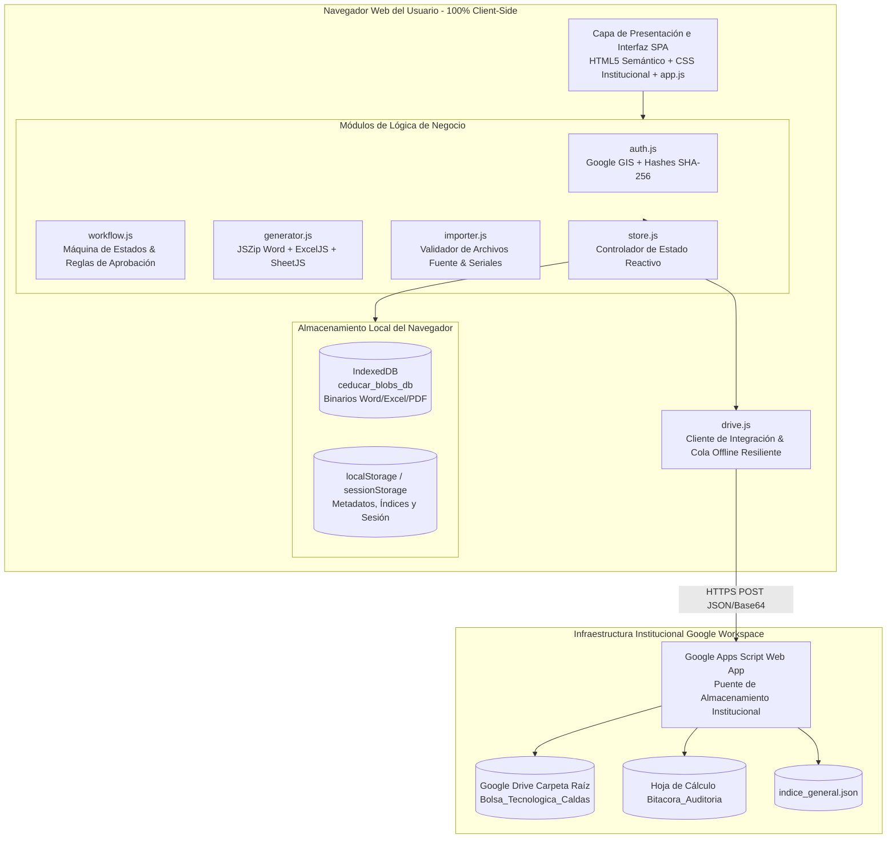
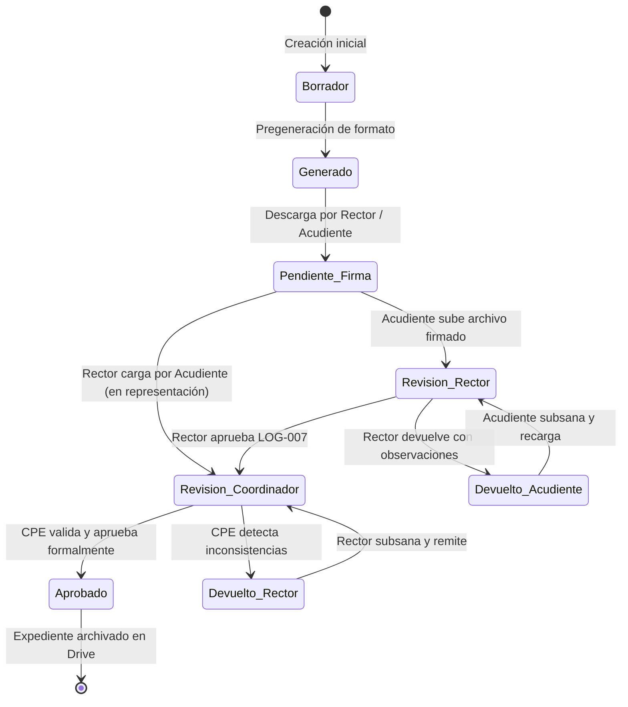

# Documentación Técnica del Sistema de Gestión Documental
## Secretaría de Educación de Caldas & Computadores para Educar

**Versión:** 2.0.0  
**Fecha de Publicación:** Octubre 2026  
**Entorno de Ejecución:** Web Client-Side (GitHub Pages / Servidor Estático)  
**Cobertura Institucional:** 22 Municipios del Departamento de Caldas, 42 Sedes Educativas, Dotaciones de Bolsa Tecnológica y Equipos para Estudiantes Focalizados.

---

## 1. Resumen Ejecutivo y Alcance del Sistema

El **Sistema de Gestión Documental de Dotación Tecnológica** es una solución informática concebida para la Secretaría de Educación Departamental de Caldas en alianza con el programa nacional **Computadores para Educar (CPE)**. Su objetivo primordial es automatizar, centralizar, legalizar y auditar integralmente el ciclo de vida de los expedientes documentales asociados a la entrega de equipamiento tecnológico:

1. **Bolsa Tecnológica Departamental:** Dotación de hardware avanzado (portátiles de diseño, estaciones de trabajo torre, impresoras 3D, filamento PLA, pantallas interactivas, kits de robótica Micro:bit, Arduino, Jetson Nano, laboratorios STEM y sensores de agricultura inteligente) para sedes educativas oficiales.
2. **Equipos para Estudiantes Beneficiarios:** Asignación individual y legalización directa a acudientes de tabletas y terminales de cómputo para estudiantes de zonas rurales y urbanas vulnerables.

### Principios de Diseño
- **100% Client-Side / Serverless:** Operación completa en el navegador web del usuario final mediante APIs estándar de HTML5, CSS3 y ECMAScript 2022. No requiere servidor backend aplicativo ni base de datos SQL/NoSQL externa dependiente de infraestructura física propia.
- **Trazabilidad Inmutable y Resiliencia:** Toda acción (inicio de sesión, generación, firma, devolución, aprobación o importación) genera un registro de auditoría estricto. La persistencia combina almacenamiento local (`IndexedDB` y `localStorage`) con un puente transparente hacia la carpeta compartida institucional de **Google Drive**.
- **Regla Fundamental de Integridad:** La carga de documentos firmados o corregidos actualiza el documento original preservando su identificador único y generando un historial de versiones sucesivas (`v01`, `v02`, ...), impidiendo la creación de expedientes huérfanos o duplicados.
- **Acceso Democrático y Seguro:** Interfaz sin fricción para rectores y acudientes, con validación criptográfica SHA-256 para credenciales del personal oficial y sin exponer tokens sensibles en texto plano.

---

## 2. Arquitectura de la Solución

### 2.1 Diagrama de Arquitectura de Capas



### 2.2 Estrategia de Persistencia Dual e Integración con Google Drive

Para garantizar la disponibilidad en zonas con conectividad intermitente y proteger la privacidad de los enlaces institucionales:
1. **Modo Puente (Apps Script - Primario):** Las transacciones y archivos binarios en base64 se transmiten vía HTTPS al Web App institucional desplegado en Google Apps Script (`Code.gs`). El script se ejecuta bajo la identidad de la cuenta propietaria de la carpeta compartida, de modo que los usuarios no necesitan cuenta de Google corporativa ni ven el enlace directo de la carpeta.
2. **Modo OAuth 2.0 (Google Identity Services - Secundario):** Si el puente no se encuentra disponible y el usuario inicia sesión con cuenta institucional de Google, el cliente `drive.js` utiliza llamadas REST directas a Google Drive API v3.
3. **Cola Local Resiliente (Offline-First):** En caso de falla de conexión o modo local, las operaciones se encolan en `localStorage` (`ceducar_drive_queue`). Una vez recuperada la conexión o activado el botón "Sincronizando", la cola se vacía automáticamente en lotes controlados (`flushQueue`).

---

## 3. Estructura de Módulos y Código Fuente

El repositorio se organiza de forma modular y desacoplada:

```
c:\Users\hadiaz\Downloads\Ceducar\ComputadoresParaEducar\
├── index.html                  # Punto de entrada de la aplicación SPA
├── apps-script/
│   ├── Code.gs                 # Código fuente del Web App puente para Google Drive
│   └── README.md               # Instrucciones de despliegue del puente
├── css/
│   └── styles.css              # Sistema de diseño institucional Gobernación de Caldas
├── data/
│   └── seed_data.json          # Datos maestros iniciales (Municipios, Sedes, Estudiantes, Dotación)
├── js/
│   ├── app.js                  # Controlador general de la interfaz, eventos y renderizado
│   ├── auth.js                 # Servicio de autenticación (OAuth 2.0 y hashes SHA-256)
│   ├── drive.js                # Cliente de sincronización con Google Drive y cola offline
│   ├── generator.js            # Motor de diligenciamiento OpenXML (Word) y hojas Excel
│   ├── importer.js             # Parser y validador de archivos Excel y lotes de seriales
│   ├── store.js                # Almacén de datos (State Management + IndexedDB + LocalStorage)
│   └── workflow.js             # Máquina de estados documental y reglas de transición
├── templates/
│   ├── LOG-007-F.docx          # Plantilla oficial entrega de equipos a estudiantes
│   ├── LOG-026-F.docx          # Plantilla oficial acta de legalización bolsa tecnológica
│   ├── LOG-029-F.xlsx          # Plantilla oficial informe validación técnica bolsa
│   ├── Acta_Consolidada_LOG-007.xlsx # Plantilla consolidada departamental
│   ├── BOLSA_TECNOLOGICA_CALDAS.xlsx # Archivo maestro de referencia bolsa
│   └── BASE_ESTUDIANTES_CALDAS.xlsx  # Archivo maestro de referencia estudiantes
├── tests/
│   ├── simulate_google_drive.js# Suite de simulación y pruebas del cliente Drive
│   ├── test_logic.js           # Pruebas unitarias de integridad, plantillas y lógica
│   └── test_runner.html        # Ejecutor de pruebas visual en navegador
└── vendor/
    ├── exceljs.min.js          # Manipulación avanzada de estilos y fórmulas XLSX
    ├── jszip.min.js            # Compresión y lectura/escritura OpenXML (.docx / .xlsx)
    └── xlsx.full.min.js        # Parser SheetJS de alta velocidad para importación
```

---

## 4. Detalle Técnico de Módulos Core

### 4.1 `store.js` - Gestión de Estado Reactivo y Almacén Binario
- **IndexedDB (`ceducar_blobs_db`):** Almacena objetos binarios de gran tamaño (`files` store) asociados a claves estructuradas (`DOC-{id}-v{version}` y `DOC-{id}-active`).
- **LocalStorage:** Mantiene el estado estructurado del sistema:
  - `municipios`: 22 municipios codificados según DANE.
  - `instituciones`: Establecimientos educativos vinculados al municipio.
  - `sedes`: Sedes oficiales con radicado y código DANE.
  - `bolsa_elementos`: Inventario clasificado con seriales, cantidades y descripciones técnicas.
  - `estudiantes`: Estudiantes beneficiarios con documento, grado, acudiente y serial de terminal.
  - `documentos`: Registro de expedientes con estado, radicado, versión y enlaces a Drive.
  - `versiones`: Historial de cambios por documento (versión, actor, observaciones, timestamp).
  - `historial_auditoria`: Bitácora inmutable de eventos del sistema.
- **Patrón Observador:** Los componentes se suscriben mediante `store.subscribe(callback)` para actualizar la interfaz automáticamente ante cualquier mutación.

### 4.2 `generator.js` - Motor de Manipulación OpenXML en Navegador
El motor realiza manipulación binaria pura de estándares OpenXML sin requerir librerías de servidor como Microsoft Word Interop o LibreOffice:

#### Generación de LOG-026-F (.docx)
1. Descomprime en memoria la plantilla base `LOG-026-F.docx` utilizando `JSZip`.
2. Lee y procesa el árbol DOM XML de `word/document.xml` y `word/header1.xml`.
3. Inyecta en el encabezado institucional el **Radicado de la Sede**, reemplazando las marcas de combinación (`MERGEFIELD Radicado` / `«Radicado»`) y conservando los contadores dinámicos `PAGE` y `NUMPAGES`.
4. Rellena la tabla de información básica: Institución, Sede, Código DANE Sede, Municipio, Fecha en texto formal, Nombres del Rector y del Profesional de Logística de CPE (Yuby Caterine Bohórquez Rojas).
5. Construye dinámicamente las filas de la tabla de elementos con una cuadrícula fija (`w:tblLayout w:type="fixed"`) de 6 columnas calculada exactamente en **10.772 dxa (19,00 cm)**, evitando cualquier deformación horizontal de márgenes.
6. Tipografía institucional estricta en `Arial Narrow` con tamaños adaptativos (`w:sz` de 18 o 16 según longitud de texto).

#### Diligenciamiento de LOG-029-F (.xlsx)
1. Carga la plantilla `LOG-029-F.xlsx` en memoria mediante `ExcelJS`.
2. Conserva intactas las hojas protegidas de validación, entre ellas `Catalogo de Elementos` y `Lista Elementos`.
3. Realiza un mapeo estricto del nombre del elemento tecnológico hacia el catálogo oficial de CPE mediante la función interna `_mapItemToCatalogueName()`, evitando errores de validación de datos en Excel.
4. Completa la hoja `Formulario` con los datos del radicado, código DANE de la sede, municipio, estado de entrega, marca, modelo, seriales y firmas.

#### Generación de LOG-007-F (.docx)
1. Carga la plantilla `LOG-007-F.docx` para entrega directa de equipos a estudiantes.
2. Inyecta los datos del estudiante beneficiario, código DANE, institución, sede, acudiente registrado y el **Serial Oficial de la Terminal** (tableta o portátil) asignado.
3. Deja listas las secciones de aceptación de términos, compromisos de cuidado y firma del acudiente y del rector.

#### Acta Consolidada LOG-007 (.xlsx)
1. Consolida a nivel de institución o de departamento la totalidad de estudiantes beneficiarios en una hoja de cálculo profesional con estilos institucionales, cabeceras en verde bandera, filtros y fórmulas de totales.

#### Empaquetador Masivo ZIP y Manifiesto CSV
1. Permite al Coordinador Departamental seleccionar un filtro (por municipio, tipo documental o estado).
2. Genera un archivo ZIP que contiene los documentos seleccionados junto con el archivo oficial `MANIFIESTO_DOCUMENTAL.csv` con los campos: `ID_Documento`, `Tipo_Documento`, `Municipio`, `Institucion_Educativa`, `Codigo_DANE_Sede`, `Nombre_Sede`, `Radicado`, `Beneficiario_Serial`, `Estado_Actual`, `Version_Actual`, `Ultima_Modificacion`, `Actor_Ultima_Accion`.

---

## 5. Máquina de Estados y Ciclo de Vida Documental

### 5.1 Diagrama de Estados del Expediente



### 5.2 Matriz de Transiciones y Permisos por Rol

| Estado Origen | Evento / Acción | Rol Ejecutor | Estado Destino | Actualiza Archivo Original | Justificación de Auditoría |
|---|---|---|---|:---:|---|
| *Cualquiera* | Pregenerar Masivo | Administrador / Sistema | `Generado` | Sí (v01) | Inicialización automática |
| `Generado` | Carga de documento firmado | Acudiente | `En revisión del rector` | Sí (v+1) | Firma manuscrita/digital |
| `Generado` / `Devuelto` | Carga en nombre de acudiente | Rector | `En revisión del coordinador` | Sí (v+1) | Requiere motivo de representación |
| `En revisión del rector` | Aprobar documento | Rector | `En revisión del coordinador` | No (mismo blob) | Visto bueno de rectoría |
| `En revisión del rector` | Devolver documento | Rector | `Devuelto al acudiente` | No | Requiere motivo y detalle |
| `En revisión del coordinador` | Aprobar documento formal | Coordinador CPE | `Aprobado` | Sí (sincroniza Drive) | Validación final institucional |
| `En revisión del coordinador` | Devolver documento | Coordinador CPE | `Devuelto al rector` | No | Requiere motivo y detalle |
| `Devuelto al rector` | Cargar en nombre de rector | Coordinador CPE | `Aprobado` | Sí (v+1) | Requiere motivo de representación |

---

## 6. Seguridad, Autenticación y Auditoría

### 6.1 Modelo Zero-Trust en el Navegador
- **Sin contraseñas en código fuente:** Las credenciales del personal de Coordinación CPE y Administrador General se validan mediante la función criptográfica nativa del navegador `crypto.subtle.digest('SHA-256', data)`. En el código fuente únicamente se registran los hashes digest correspondientes (`_STAFF_HASHES` y `_AUTH_HASHES`).
- **Autenticación de Rectores:** Se autentican mediante el código DANE oficial de su establecimiento educativo y/o su clave institucional, restringiendo el alcance de visualización exclusivamente a sus sedes y estudiantes asignados.
- **Autenticación de Acudientes:** Se autentican directamente mediante el documento de identidad del estudiante o del acudiente registrado en la matrícula oficial, sin necesidad de crear correos electrónicos o contraseñas adicionales.

### 6.2 Estructura del Registro de Auditoría
Cada evento registra:
```json
{
  "id": "aud_1729900000000",
  "timestamp": "2026-10-27T13:30:00.000Z",
  "actor": "Coordinador CPE - Caldas",
  "rol": "coordinador",
  "accion": "APROBACION_DOCUMENTO",
  "entidad": "LOG-026-F",
  "entidad_id": "DOC-026-117013000244",
  "detalles": "Documento validado y aprobado formalmente por la Coordinación Departamental."
}
```

---

## 7. Estructura del Almacenamiento en Google Drive

La carpeta raíz institucional (`Bolsa_Tecnologica_Caldas`) mantiene la siguiente jerarquía normalizada:

```
Bolsa_Tecnologica_Caldas/
├── {Municipio}/
│   └── {Institucion_Educativa}/
│       └── {Nombre_Sede}/
│           ├── LOG-026-F/
│           │   ├── Generado/
│           │   └── Aprobado/
│           ├── LOG-029-F/
│           │   ├── Generado/
│           │   └── Aprobado/
│           └── LOG-007-F/
│               └── {Documento_Estudiante}/
│                   ├── Generado/
│                   ├── En_Revision/
│                   └── Aprobado/
├── Historial/
│   └── Bitacora_Auditoria (Hoja de cálculo actualizada en tiempo real)
└── Indices/
    └── indice_general.json (Snapshot de metadatos del sistema)
```

---

## 8. Guía de Pruebas y Validación Técnica

El proyecto incluye dos niveles de verificación automatizada:

1. **Pruebas en Línea de Comandos (Node.js):**
   ```bash
   node tests/test_logic.js
   ```
   *Verifica:* Integridad de `seed_data.json`, conteo de municipios y sedes, presencia de seriales oficiales, manipulación binaria de OpenXML en `LOG-026-F.docx`, existencia de columnas a 19 cm, encabezados dinámicos y compatibilidad con `ExcelJS`.

2. **Simulación de Google Drive:**
   ```bash
   node tests/simulate_google_drive.js
   ```
   *Verifica:* Creación de carpetas anidadas en Drive, subida de archivos binarios, serialización de bitácora y recuperación de índices.

3. **Ejecutor Visual en Navegador:**
   Abriendo `tests/test_runner.html` en cualquier navegador web se ejecutan las pruebas visuales con reporte en tiempo real de assertions aprobadas.
