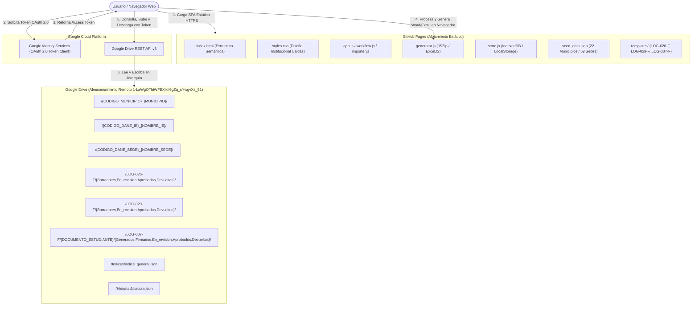

# Arquitectura Sin Servidor — Sistema de Gestión Documental

## 1. Visión General de la Arquitectura

La aplicación es una **Single Page Application (SPA) 100% estática** alojada en **GitHub Pages**, diseñada para operar de forma descentralizada sin ningún servidor propio, backend, funciones serverless ni base de datos externa.

Google Drive actúa como el **único almacenamiento remoto** para plantillas oficiales, documentos generados, archivos firmados, índices y bitácoras de auditoría.

## 2. Componentes del Frontend

| Componente | Archivo | Responsabilidad |
|---|---|---|
| **Almacén Local** | `js/store.js` | Persistencia en LocalStorage e IndexedDB para blobs; auditoría local y sincronización. |
| **Cliente Drive** | `js/drive.js` | Peticiones directas a la API v3 de Drive (Multipart Upload, búsqueda jerárquica de carpetas). |
| **Autenticación** | `js/auth.js` | Flujo de token interactivo Google Identity Services (GIS) y credenciales auxiliares. |
| **Generador Documental** | `js/generator.js` | Modificación de XML de Word (LOG-026-F y LOG-007-F) y celdas Excel (LOG-029-F); empaquetador ZIP. |
| **Máquina de Estados** | `js/workflow.js` | Transiciones de estado documental, observaciones, validaciones y registro de representación. |
| **Importador de Datos** | `js/importer.js` | Lectura de Excel, validación de encabezados, vista previa de discrepancias y actualización de seriales. |
| **Controlador UI** | `js/app.js` | Renderizado adaptado para Administrador, Coordinador, Rector y Acudiente. |

## 3. Limitaciones Técnicas y de Seguridad Inherentes

Al no contar con backend, se deben tener presentes las siguientes restricciones:

1. **Ausencia de Secretos en el Frontend:** El Client ID de Google OAuth es público. No se almacena ninguna clave secreta ni token de servicio en el repositorio.
2. **Autorización Derivada de Drive:** Las restricciones de acceso a los archivos dependen exclusivamente de los permisos que la cuenta de Google del usuario tenga sobre la carpeta compartida en Drive.
3. **Control de Concurrencia Optimista:** Si dos usuarios editan el mismo expediente simultáneamente, la aplicación detecta el conflicto comparando versiones locales, pero no existe bloqueo de transacciones ACID en Drive.
4. **Auditoría Mutable:** Los registros históricos se almacenan como archivos JSON en Google Drive; usuarios con permisos de escritura en Drive podrían modificarlos externamente.
