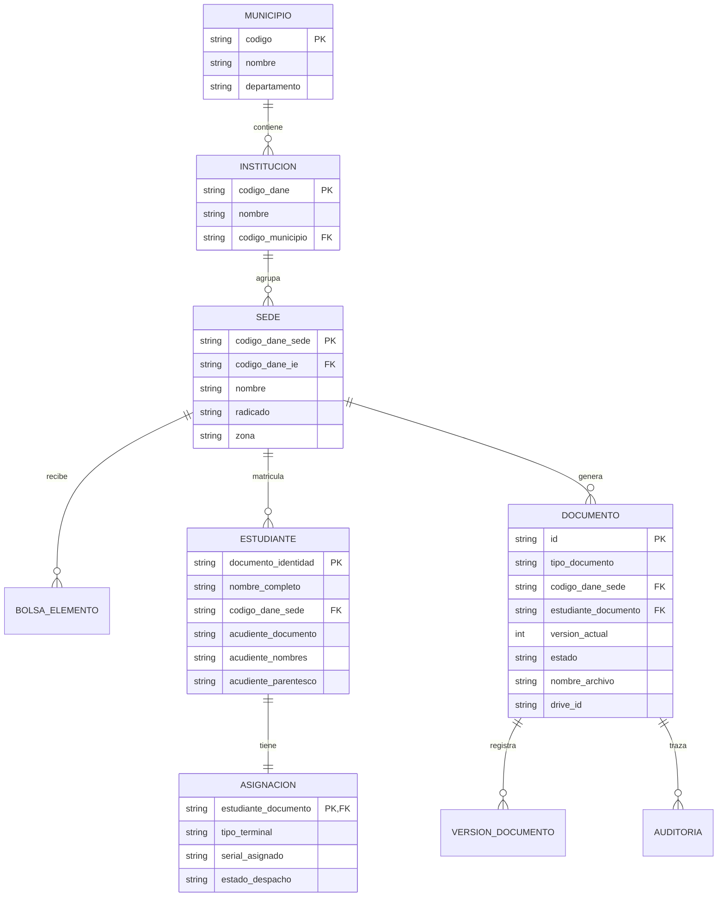

# Modelo Lógico de Archivos, Índices y Diccionario de Datos

## 1. Estructura Jerárquica de Google Drive

ID de Carpeta Raíz: `1-LaWgOThiWFEXlxiI6gZq_sYwgvXs_51`
Nombre de Carpeta Raíz: `/Bolsa_Tecnologica_Caldas/`

```text
/Bolsa_Tecnologica_Caldas/
  ├── Indices/
  │   └── indice_general.json
  ├── Historial/
  │   └── evento_AUD-*.json
  └── {CODIGO_MUNICIPIO}_{MUNICIPIO}/
      └── {CODIGO_DANE_IE}_{NOMBRE_IE}/
          └── {CODIGO_DANE_SEDE}_{NOMBRE_SEDE}/
              ├── LOG-026-F/
              │   ├── Borradores/
              │   ├── En_revision/
              │   ├── Aprobados/
              │   └── Devueltos/
              ├── LOG-029-F/
              │   ├── Borradores/
              │   ├── En_revision/
              │   ├── Aprobados/
              │   └── Devueltos/
              └── LOG-007-F/
                  └── {DOCUMENTO_ESTUDIANTE}/
                      ├── Generados/
                      ├── Firmados/
                      ├── En_revision/
                      ├── Aprobados/
                      └── Devueltos/
```

## 2. Diagrama de Relaciones Lógicas



## 3. Diccionario de Datos

### 3.1 Municipios
| Campo | Tipo | Requerido | Descripción |
|---|---|---|---|
| `codigo` | String | Sí | Código DANE del municipio (ej. `17042`). Tratado siempre como texto. |
| `nombre` | String | Sí | Nombre oficial del municipio (ej. `Anserma`). |
| `departamento` | String | Sí | Nombre del departamento (`Caldas`). |

### 3.2 Sedes
| Campo | Tipo | Requerido | Descripción |
|---|---|---|---|
| `codigo_dane_sede` | String | Sí | Código DANE único de 12 dígitos de la sede educativa. |
| `codigo_dane_ie` | String | Sí | Código DANE de la institución principal. |
| `nombre` | String | Sí | Nombre de la sede educativa. |
| `radicado` | String | No | Número de radicado de entrega asignado por CPE. |
| `zona` | String | Sí | Zona geográfica (`RURAL` o `URBANA`). |

### 3.3 Estudiantes y Asignaciones
| Campo | Tipo | Requerido | Descripción |
|---|---|---|---|
| `documento_identidad` | String | Sí | Documento de identidad del estudiante beneficiario. |
| `nombre_completo` | String | Sí | Nombres y apellidos completos del estudiante. |
| `acudiente_documento` | String | No | Cédula del acudiente responsable. |
| `acudiente_nombres` | String | No | Nombre del padre, madre o acudiente. |
| `tipo_terminal` | String | Sí | `Portátil` o `Tableta`. |
| `serial_asignado` | String | Sí | Serial alfanumérico del equipo tecnológico. |

### 3.4 Documentos y Trazabilidad
| Campo | Tipo | Requerido | Descripción |
|---|---|---|---|
| `id` | String | Sí | Identificador único del expediente (`DOC-timestamp-hash`). |
| `tipo_documento` | String | Sí | `LOG-026-F`, `LOG-029-F` o `LOG-007-F`. |
| `version_actual` | Entero | Sí | Número correlativo de versión vigente (1, 2, ...). |
| `estado` | String | Sí | Estado del flujo documental. |
| `drive_id` | String | No | Identificador del archivo en Google Drive API v3. |
| `actor_ultima_accion`| String | Sí | Nombre de la persona o perfil que realizó la última transición. |
