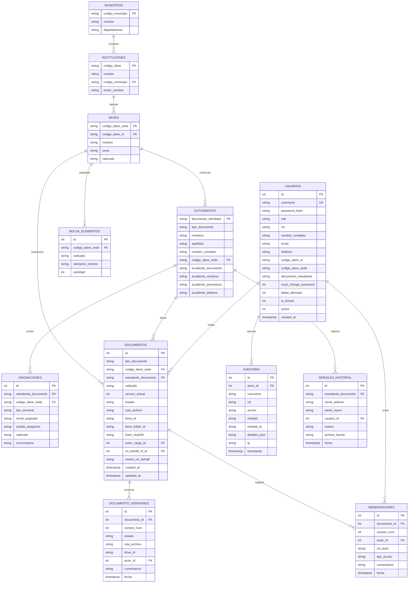

# Modelo Entidad-Relación y Diccionario de Datos

Este documento define el modelo de datos relacional y el diccionario de datos del sistema, implementado en SQLite conforme a las secciones 4, 11 y 16 de `SKILL.md`.

---

## 1. Diagrama Entidad-Relación

---

## 2. Diccionario de Datos

### 2.1 Tabla `usuarios`
| Campo | Tipo | Restricciones | Descripción |
| :--- | :--- | :--- | :--- |
| `id` | INTEGER | PK, Auto | Identificador secuencial único |
| `username` | TEXT | UNIQUE, NOT NULL | Nombre de usuario (DANE, cédula o alias) |
| `password_hash` | TEXT | NOT NULL | Resumen criptográfico PBKDF2-HMAC-SHA256 |
| `salt` | TEXT | NOT NULL | Sal criptográfica de 16 bytes aleatorios |
| `rol` | TEXT | NOT NULL | Rol: 'administrador', 'coordinador', 'rector', 'acudiente' |
| `nombre_completo` | TEXT | NOT NULL | Nombre y apellidos del usuario |
| `email` | TEXT | NULL | Correo electrónico de contacto |
| `telefono` | TEXT | NULL | Teléfono institucional o celular |
| `codigo_dane_ie` | TEXT | NULL | Código DANE de institución (para rectores) |
| `codigo_dane_sede` | TEXT | NULL | Código DANE de sede asignada |
| `documento_estudiante` | TEXT | NULL | Cédula/TI del menor (para acudientes) |
| `must_change_password` | INTEGER | DEFAULT 0 | 1 si debe cambiar contraseña en primer acceso |
| `failed_attempts` | INTEGER | DEFAULT 0 | Contador de accesos fallidos consecutivos |
| `is_locked` | INTEGER | DEFAULT 0 | 1 si está bloqueado por intentos fallidos |
| `active` | INTEGER | DEFAULT 1 | 1 activo, 0 inactivo (borrado lógico) |
| `created_at` | TIMESTAMP | DEFAULT CURRENT_TIMESTAMP | Fecha de creación del registro |

### 2.2 Tabla `documentos`
| Campo | Tipo | Restricciones | Descripción |
| :--- | :--- | :--- | :--- |
| `id` | INTEGER | PK, Auto | Identificador único del expediente documental |
| `tipo_documento` | TEXT | CHECK: LOG-007-F, LOG-026-F, LOG-029-F | Tipo de formato oficial |
| `codigo_dane_sede` | TEXT | FK sedes | Sede educativa beneficiaria |
| `estudiante_documento`| TEXT | FK estudiantes, NULL | Documento del estudiante (solo LOG-007-F) |
| `radicado` | TEXT | NULL | Radicado oficial de asignación |
| `version_actual` | INTEGER | DEFAULT 1 | Número de versión vigente |
| `estado` | TEXT | NOT NULL | Estado actual en el ciclo de aprobación |
| `ruta_archivo` | TEXT | NOT NULL | Ruta física del archivo generado o cargado |
| `drive_id` | TEXT | NULL | Identificador del archivo en Google Drive |
| `drive_folder_id` | TEXT | NULL | Identificador de la carpeta en Google Drive |
| `hash_sha256` | TEXT | NULL | Huella digital criptográfica del archivo |
| `autor_carga_id` | INTEGER | FK usuarios, NULL | Usuario que realizó la última carga |
| `on_behalf_of_id` | INTEGER | FK usuarios, NULL | Rol en nombre de quien se realizó la acción |
| `motivo_on_behalf` | TEXT | NULL | Justificación formal de la actuación en nombre de otro |

### 2.3 Tabla `observaciones`
| Campo | Tipo | Restricciones | Descripción |
| :--- | :--- | :--- | :--- |
| `id` | INTEGER | PK, Auto | Identificador de la observación |
| `documento_id` | INTEGER | FK documentos | Documento asociado |
| `version_num` | INTEGER | NOT NULL | Versión del documento al emitir la observación |
| `autor_id` | INTEGER | FK usuarios | Usuario que formuló la observación |
| `rol_autor` | TEXT | NOT NULL | Rol del autor |
| `tipo_accion` | TEXT | CHECK: devolucion, aprobacion, carga, comentario, generacion | Tipo de evento |
| `comentarios` | TEXT | NOT NULL | Texto explicativo detallado de la observación |
| `fecha` | TIMESTAMP | DEFAULT CURRENT_TIMESTAMP | Fecha y hora de emisión |

### 2.4 Tabla `auditoria`
| Campo | Tipo | Restricciones | Descripción |
| :--- | :--- | :--- | :--- |
| `id` | INTEGER | PK, Auto | Identificador del registro de auditoría |
| `actor_id` | INTEGER | NULL | ID del usuario ejecutor |
| `username` | TEXT | NULL | Nombre de usuario ejecutor |
| `rol` | TEXT | NULL | Rol del ejecutor |
| `accion` | TEXT | NOT NULL | Acción realizada (ej. LOGIN, TRANSICION, CARGA) |
| `entidad` | TEXT | NOT NULL | Tabla o módulo afectado |
| `entidad_id` | TEXT | NULL | Identificador del registro afectado |
| `detalles_json` | TEXT | NULL | Detalle de la operación en formato JSON |
| `ip` | TEXT | NULL | Dirección IP del cliente |
| `timestamp` | TIMESTAMP | DEFAULT CURRENT_TIMESTAMP | Marca de tiempo inmutable |
