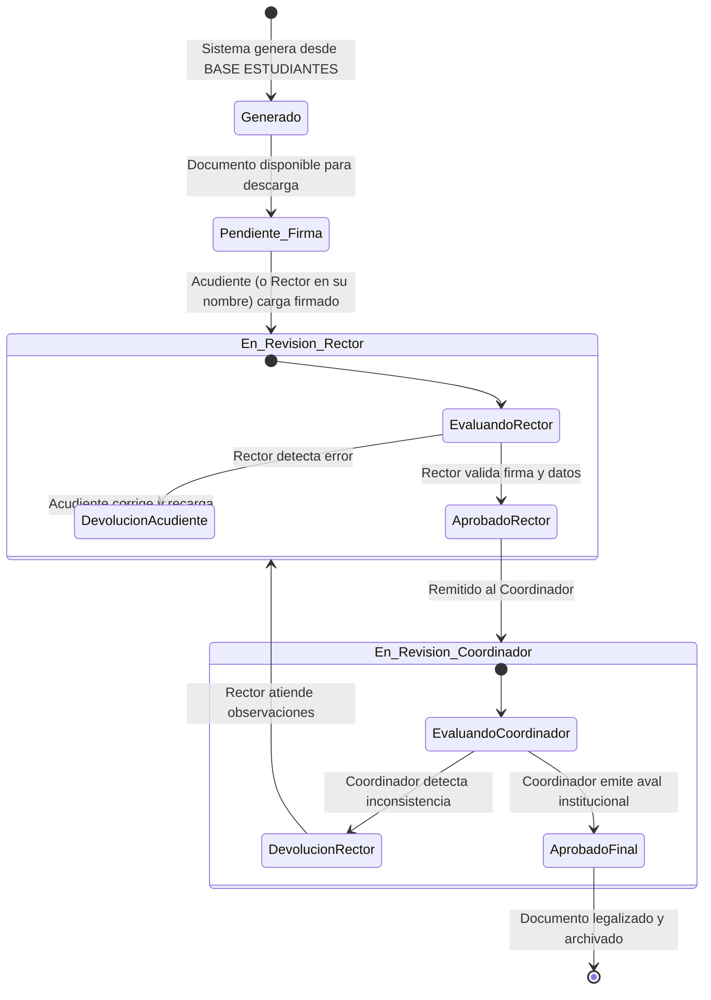
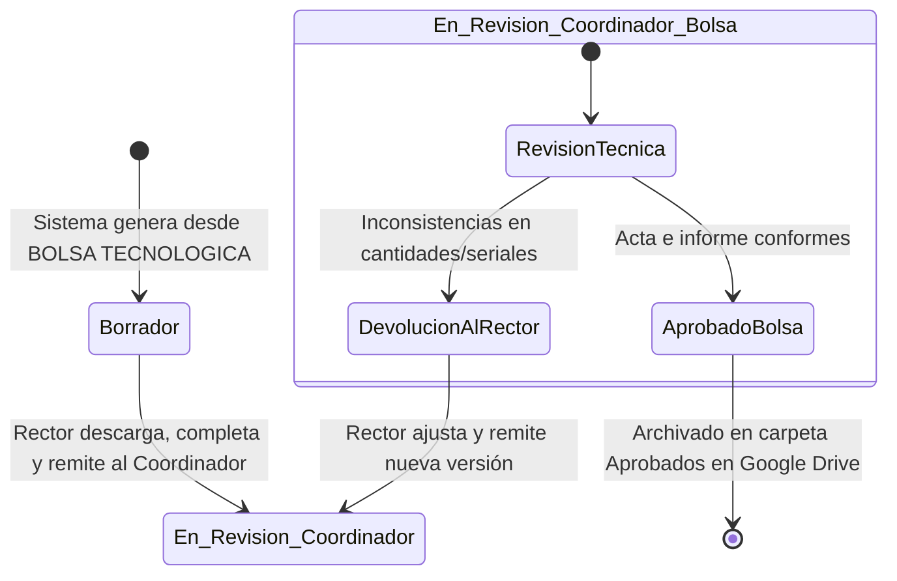

# Diagrama de Estados del Flujo de Aprobación

Este documento modela el ciclo de vida documental y la máquina de estados de los formatos institucionales, conforme a la Sección 10 de `SKILL.md`.

---

## 1. Ciclo de Vida del Formato LOG-007-F (Entrega a Estudiantes)

---

## 2. Ciclo de Vida de los Formatos LOG-026-F y LOG-029-F (Bolsa Tecnológica)

---

## 3. Catálogo de Estados

| Estado | Significado Institucional | Acción Requerida | Actor Responsable |
| :--- | :--- | :--- | :--- |
| **Borrador** | Formato generado inicialmente con datos base | Descargar, revisar y complementar campos pendientes | Rector / Sistema |
| **Generado** | Documento generado automáticamente para estudiante | Descargar y firmar físicamente | Acudiente |
| **Pendiente de firma/carga** | Formato descargado a la espera de la versión suscrita | Cargar copia digitalizada o foto legible | Acudiente (o Rector) |
| **En revisión del rector** | Documento firmado cargado y en espera de verificación escolar | Validar matrícula, parentesco y firma | Rector |
| **Devuelto al acudiente** | Rechazado por rector con observaciones específicas | Corregir el documento y volver a cargarlo | Acudiente |
| **En revisión del coordinador** | Avalado por rector o remitido formalmente para control departamental | Revisión final técnica y documental | Coordinador |
| **Devuelto al rector** | Devuelto por coordinador por inconsistencias | Subsanar novedades con sede o acudiente | Rector |
| **Aprobado** | Documento con validez legal completa archivado definitivamente | Ninguna; disponible para auditoría y exportación | Coordinador / Sistema |

---

## 4. Reglas Críticas del Flujo
1. **La carga de un archivo no equivale a su aprobación:** La aprobación requiere una acción explícita del rol competente.
2. **Devolución con causa motivada:** No se admiten devoluciones sin registrar el motivo y las observaciones que orienten al usuario a corregir.
3. **Inmutabilidad y Versionamiento:** Cualquier corrección incrementa el número de versión (`v01`, `v02`, etc.) y archiva la versión anterior en el historial.
4. **Trazabilidad de Representación (`on_behalf_of`):** Si un rector o coordinador actúa en nombre de un tercero, el sistema audita de forma indeleble: quién ejecutó la acción, en nombre de quién actuó, la fecha exacta y la justificación formal.
