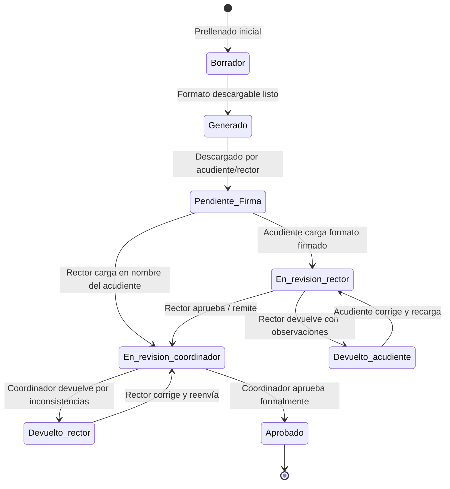
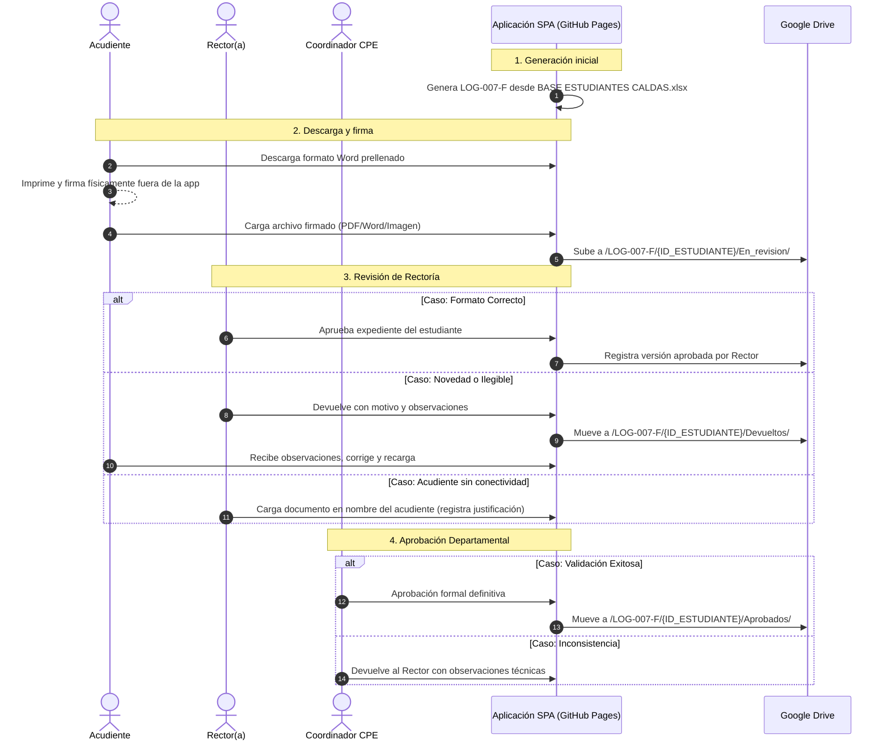

# Diagrama de Estados del Flujo de Aprobación Documental

## 1. Ciclo de Vida General

El ciclo de vida de los formatos institucionales (LOG-007-F, LOG-026-F y LOG-029-F) sigue la siguiente secuencia de estados:

## 2. Flujo Específico LOG-007-F (Entrega Directa a Estudiante)

## 3. Flujo LOG-026-F y LOG-029-F (Bolsa Tecnológica Institucional)

1. **Generación:** El sistema genera el acta Word (LOG-026-F) y el informe Excel (LOG-029-F) desde `BOLSA TECNOLOGICA CALDAS.xlsx`.
2. **Diligenciamiento:** El Rector descarga los formatos, realiza la verificación física en sede y diligencia observaciones y firmas.
3. **Carga y Remisión:** El Rector carga los formatos finales y los remite a Coordinación.
4. **Revisión Departamental:** El Coordinador valida las cantidades y catálogos:
   - Si es conforme: Aprueba formalmente.
   - Si hay diferencias: Devuelve al Rector con motivo detallado para corrección y nueva versión.
